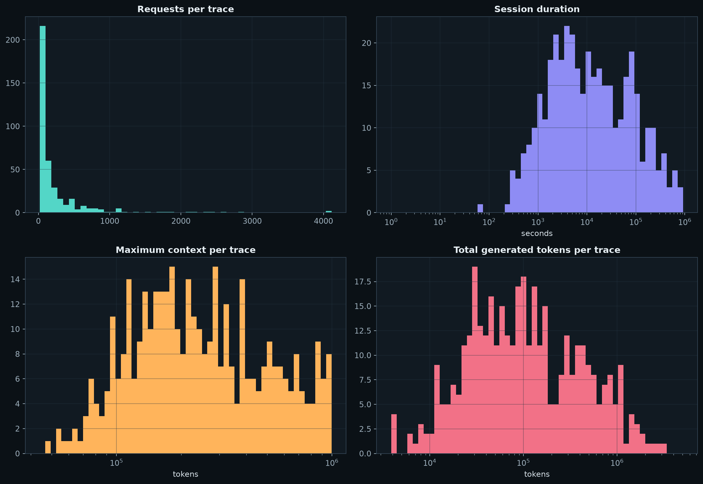
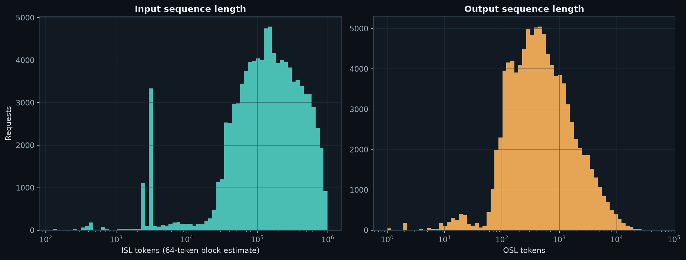
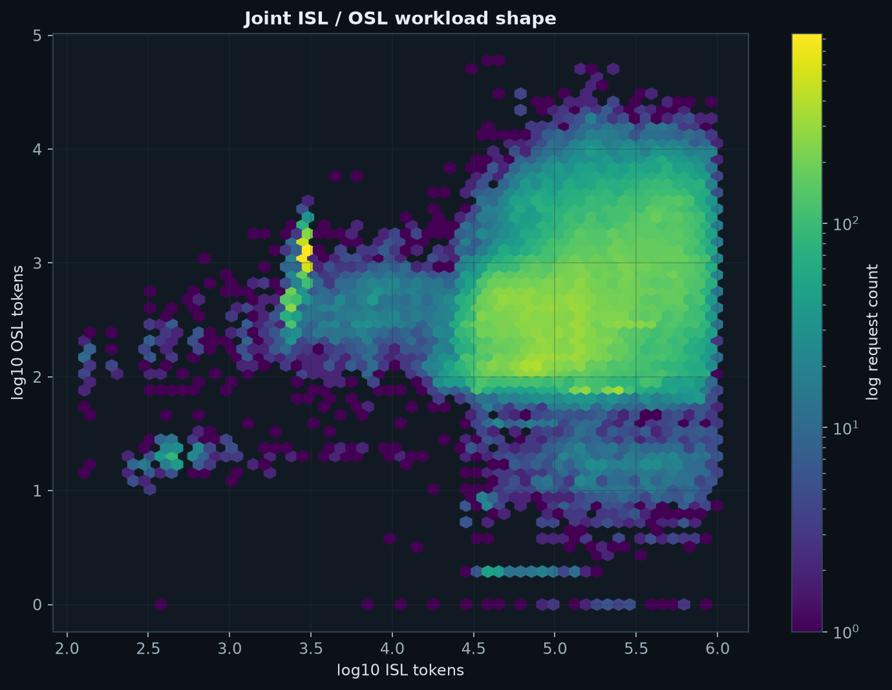
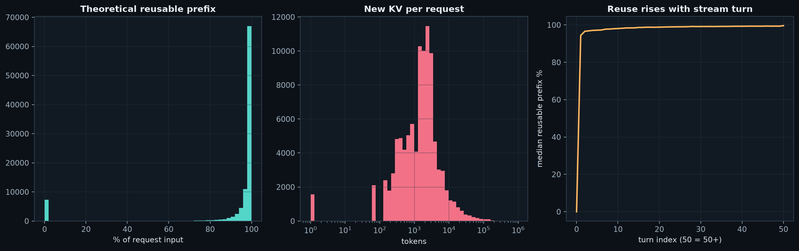
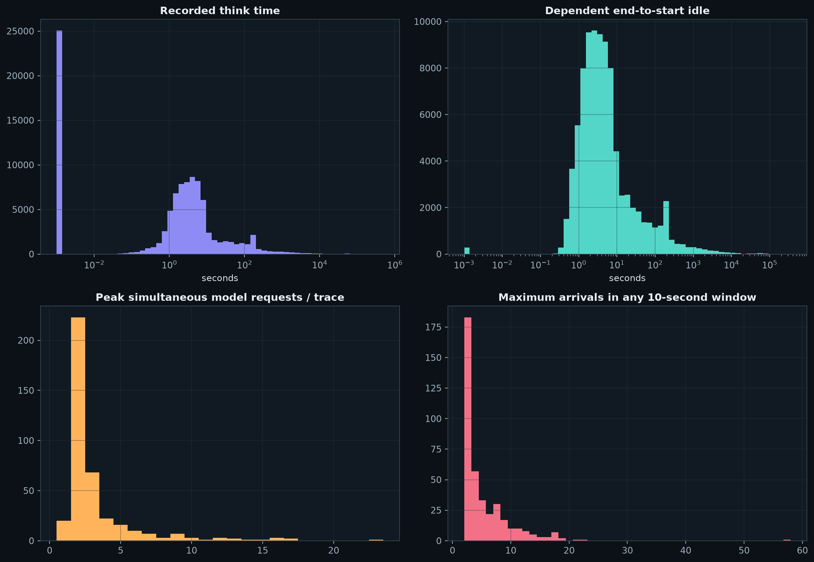
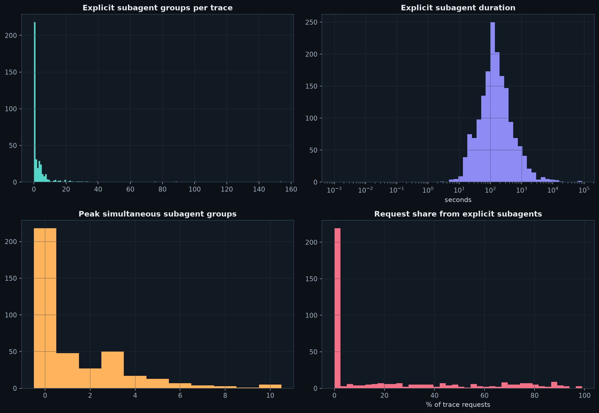
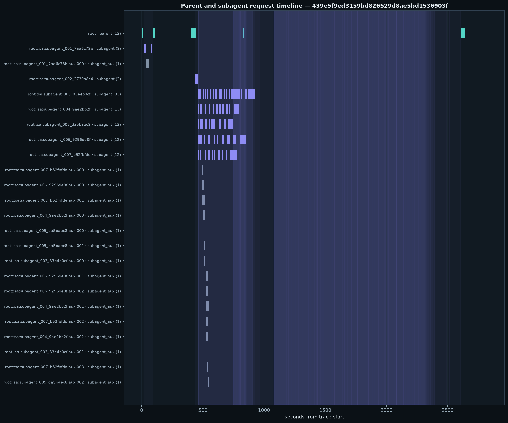

# SemiAnalysis AgentX Claude Code trace analysis

**Corpus:** `semianalysisai/cc-traces-weka-062126` at revision `23f152f6f0f9399a85901b89a6458def0ef16729`
**Weka semantics:** AIPerf `c26fe88bd88d32740c83b4637c1e573e06df5ecc`
**Generated by:** `analyze_agentx.py`

> `hash_ids` quantify block-granular prefix reuse that is theoretically available. They do **not** report an actual runtime KV-cache hit rate; retention, eviction, routing, and finite cache capacity are not observed.

## Executive summary

The corpus contains **393 Claude Code sessions** and **98,827 model requests**. A session has a median of **86 requests** and lasts **2.8 h** at the median. Explicit subagents produce **42.5%** of all model requests; **44.5%** of sessions spawn at least one.

The median request is **142.0K input / 444 output tokens**. The request-level p99 input is **863.5K**, while the largest observed input+requested-output context is **996.6K**. The aggregate Weka-theoretical reusable prefix is **98.3%** of input tokens, leaving **365.90M** block-estimated tokens as new prefill across the corpus.

## 1. Corpus overview

| metric | value |
|---|---:|
| traces / sessions | 393 |
| model requests | 98,827 |
| outer parent-list requests | 56,798 |
| requests nested in explicit subagents | 42,029 |
| explicit subagent groups | 1,697 |
| sessions with explicit subagents | 175 (44.5%) |
| reconstructed logical streams | 9,843 |
| detected top-level worker streams | 1,422 |
| detected nested worker streams | 6,331 |

The raw outer list should not be read as one serial parent loop. AIPerf's hash-LCP detector finds independent flattened workers at the top level and additional child streams inside explicit subagent blocks. Counts above therefore separate raw storage shape from replay topology.

### Session distributions

| metric | p10 | p50 | p90 | p95 | p99 | max |
|---|---:|---:|---:|---:|---:|---:|
| requests/session | 27 | 86 | 618 | 977 | 2474 | 4114 |
| duration | 17.2 min | 2.8 h | 2.0 d | 3.6 d | 8.0 d | 10.6 d |
| explicit subagents/session | 0 | 0 | 8 | 19 | 76 | 153 |

## 2. ISL / OSL characteristics

| tokens/request | p10 | p25 | p50 | p75 | p90 | p95 | p99 | max |
|---|---:|---:|---:|---:|---:|---:|---:|---:|
| ISL | 32.7K | 64.8K | 142.0K | 310.5K | 549.5K | 682.9K | 863.5K | 989.8K |
| OSL | 107 | 192 | 444 | 1.1K | 2.7K | 4.3K | 9.3K | 59.9K |
| context (ISL+OSL) | 33.0K | 65.5K | 143.0K | 311.9K | 551.5K | 684.4K | 865.0K | 996.6K |

### Context-window exceedance

| threshold | requests | request fraction | sessions containing ≥1 | session fraction |
|---|---:|---:|---:|---:|
| 32.8K | 89,031 | 90.09% | 393 | 100.0% |
| 65.5K | 74,083 | 74.96% | 386 | 98.2% |
| 131.1K | 52,685 | 53.31% | 311 | 79.1% |
| 262.1K | 29,832 | 30.19% | 173 | 44.0% |
| 524.3K | 11,093 | 11.22% | 70 | 17.8% |
| 1.00M | 0 | 0.00% | 0 | 0.0% |

`in` is a 64-token-block estimate, not an exact tokenizer count. The source corpus already removes rows above 990,016 input tokens because heavy cache-write telemetry can overcount the real prompt.

## 3. Multi-turn context growth

A reconstructed stream has **1 turns at p50**, **23 at p90**, and **851 at maximum**. The median ISL change after turn 1 is **1.5K tokens**; the median newly introduced KV is **1.6K tokens**. Negative ISL deltas are real context shrinks/compactions and are kept rather than forced into append-only arithmetic.

| session/stream metric | p50 | p90 | p95 | p99 | max |
|---|---:|---:|---:|---:|---:|
| reconstructed parent turns/session | 45 | 152 | 246 | 411 | 765 |
| turns/logical stream | 1 | 23 | 45 | 156 | 851 |
| max context/session | 226.3K | 696.0K | 874.2K | 991.1K | 996.6K |
| generated tokens/session | 96.0K | 735.1K | 1.10M | 2.15M | 5.06M |
| requests/explicit subagent | 16 | 47 | 67 | 175 | 789 |

### Short, medium, and long-context examples

`7e370a371b3de565f62dd133bd9e496947ac` — 24 reconstructed parent turns
- turn 1: 384 ISL → 20 OSL; 0.0% theoretically reusable
- turn 2: 40.3K ISL → 415 OSL; 0.0% theoretically reusable
- turn 3: 42.0K ISL → 671 OSL; 95.9% theoretically reusable
- turn 4: 42.9K ISL → 332 OSL; 97.9% theoretically reusable
- turn 5: 44.3K ISL → 618 OSL; 97.0% theoretically reusable
- turn 6: 46.8K ISL → 289 OSL; 94.5% theoretically reusable
- turn 7: 47.2K ISL → 120 OSL; 99.3% theoretically reusable
- turn 8: 48.3K ISL → 498 OSL; 97.6% theoretically reusable
- turn 9: 48.8K ISL → 121 OSL; 99.1% theoretically reusable
- turn 10: 49.0K ISL → 784 OSL; 99.6% theoretically reusable
- turn 11: 49.7K ISL → 119 OSL; 98.6% theoretically reusable
- turn 12: 57.3K ISL → 1.2K OSL; 86.7% theoretically reusable
- … 12 additional parent turns

`a26302776b9ed6524bac18bdf9a9430f4170` — 61 reconstructed parent turns
- turn 1: 63.2K ISL → 551 OSL; 0.0% theoretically reusable
- turn 2: 65.3K ISL → 213 OSL; 96.8% theoretically reusable
- turn 3: 66.6K ISL → 650 OSL; 98.0% theoretically reusable
- turn 4: 68.0K ISL → 308 OSL; 98.0% theoretically reusable
- turn 5: 69.4K ISL → 224 OSL; 97.9% theoretically reusable
- turn 6: 71.7K ISL → 1.3K OSL; 96.8% theoretically reusable
- turn 7: 76.2K ISL → 3.6K OSL; 94.2% theoretically reusable
- turn 8: 78.1K ISL → 1.6K OSL; 97.5% theoretically reusable
- turn 9: 80.6K ISL → 3.3K OSL; 96.8% theoretically reusable
- turn 10: 82.2K ISL → 310 OSL; 98.1% theoretically reusable
- turn 11: 82.6K ISL → 210 OSL; 99.6% theoretically reusable
- turn 12: 83.8K ISL → 1.0K OSL; 98.5% theoretically reusable
- … 49 additional parent turns

`4e687509d3c9c0afa7cc8b884d120eeb0d79` — 206 reconstructed parent turns
- turn 1: 85.9K ISL → 1.9K OSL; 0.0% theoretically reusable
- turn 2: 170.3K ISL → 2.4K OSL; 50.4% theoretically reusable
- turn 3: 172.5K ISL → 2.8K OSL; 98.7% theoretically reusable
- turn 4: 174.8K ISL → 5 OSL; 98.7% theoretically reusable
- turn 5: 174.4K ISL → 3.0K OSL; 99.9% theoretically reusable
- turn 6: 177.7K ISL → 427 OSL; 98.2% theoretically reusable
- turn 7: 200.1K ISL → 9.3K OSL; 88.8% theoretically reusable
- turn 8: 203.6K ISL → 1.2K OSL; 98.3% theoretically reusable
- turn 9: 204.9K ISL → 1.2K OSL; 99.4% theoretically reusable
- turn 10: 226.3K ISL → 6.7K OSL; 90.5% theoretically reusable
- turn 11: 233.0K ISL → 1.9K OSL; 97.1% theoretically reusable
- turn 12: 234.7K ISL → 5.2K OSL; 99.3% theoretically reusable
- … 194 additional parent turns

## 4. Prefix / KV reuse

Across all replay-eligible streams, **98.3%** of block-estimated input tokens are a leading prefix whose block IDs appeared earlier in the same trace. Request-level reuse is **99.1% at p50** and **99.9% at p90**. The median request introduces **1.6K new KV tokens**, p90 **5.9K**.

Against only the previous request on the same reconstructed stream, the common-prefix ratio is **99.1% at p50** and **99.9% at p90**. The global-time metric can be higher because it also credits blocks introduced by parent or sibling branches.

The cross-branch metric follows AIPerf exactly: within a trace-local hash namespace, requests are consumed in deterministic global timestamp order and the leading run already present in a shared seen-set is reusable. Consecutive-stream LCP is also exported separately. This is a theoretical opportunity, not proof that a runtime retained or routed those blocks to the same cache.

### Reuse by stream age

| stream turn range | requests | median reuse | mean reuse |
|---|---:|---:|---:|
| 0–0 | 9,843 | 0.0% | 24.8% |
| 1–1 | 2,791 | 94.4% | 80.1% |
| 2–3 | 4,923 | 96.7% | 92.8% |
| 4–7 | 8,345 | 97.4% | 94.9% |
| 8–15 | 12,092 | 98.3% | 96.9% |
| 16–31 | 15,316 | 99.0% | 98.1% |
| 32–63 | 15,184 | 99.4% | 98.8% |
| 64–127 | 13,541 | 99.6% | 99.1% |
| 128+ | 16,792 | 99.7% | 99.1% |

### Reuse by input-context range

| ISL range | requests | median reuse | mean reuse |
|---|---:|---:|---:|
| 0–32.8K | 9,904 | 0.0% | 30.0% |
| 32.8K–65.5K | 15,121 | 97.0% | 91.6% |
| 65.5K–131.1K | 21,372 | 98.5% | 95.4% |
| 131.1K–262.1K | 22,753 | 99.3% | 98.1% |
| 262.1K–524.3K | 18,676 | 99.6% | 99.1% |
| 524.3K–1.00M | 11,001 | 99.7% | 99.5% |

## 5. Timing / agent behavior

The dependent end-to-start idle gap is **3.71s at p50**, **67.0s at p90**, and **28.8 min at p99**. Recorded think time is **2.28s at p50** and **37.6s at p90**. Across each trace's global arrival stream, 10.5% of gaps are ≤1s, 52.7% are ≤10s, and 11.1% exceed 60s.

Within a 10-second sliding window, a session produces **4 arrivals at p50**, **11 at p90**, and **58 maximum**. This combines tight subagent bursts with long waiting tails rather than resembling a stationary Poisson stream.

The corpus has only session-relative timestamps. It cannot reveal how the 393 historical sessions overlapped in absolute wall clock. Using the measured duration distribution, Little's Law gives the following workload-planning scenarios:

| new sessions/min | expected concurrently active sessions |
|---:|---:|
| 0.1 | 98.1 |
| 0.5 | 490.3 |
| 1.0 | 980.7 |
| 2.0 | 1961.3 |
| 5.0 | 4903.3 |
| 10.0 | 9806.5 |

## 6. Subagent concurrency

Explicit subagents account for **42.5%** of requests. Their median duration is **2.3 min**, p90 **12.1 min**, and p99 **1.5 h**. Peak simultaneous explicit subagent groups are **0 at p50**, **4 at p90**, and **10 maximum**. Recorded model-request concurrency reaches **2 at p50** and **23 maximum** per session.

AIPerf reconstructs 727 explicit subagent entries as more than one inner context stream. It identifies 466 background branches and 0 orphaned groups with no preceding parent anchor.

### Representative complex timeline

Each bar is one recorded model request interval. Shaded spans mark explicit subagent lifetimes; rows are AIPerf-reconstructed context streams.

## 7. Implications for serving

- **Prefix caching:** The workload offers substantial theoretical leading-prefix reuse, including across   parent/subagent branches. Realized hit rate will depend on cache residency, routing affinity, eviction,   block size, and whether concurrent branches reach the same cache shard.
- **KV memory:** Long-lived sessions combine high ISL with many simultaneous branches. Capacity planning   should use the context-tail percentiles and concurrent active streams, not only median ISL.
- **Prefill vs decode:** The measured ISL/OSL asymmetry is strongly prefill-heavy per request, but high prefix   reuse can convert much of that apparent prefill into cache lookup/reuse. New-KV tokens are the more useful   prefill demand signal.
- **Long-context attention:** A material tail crosses 128K and 256K. Experiments should preserve that tail   rather than truncate all traffic to a single context bucket.
- **Batching/concurrency:** One user session can generate overlapping parent, worker, and subagent requests;   a concurrency limit on session trees is not a request-concurrency limit.
- **P/D disaggregation:** Bursty cached-prefill arrivals, long decode-light loops, and idle think periods make   phase-specific queues plausible, but any experiment should replay the recorded timing and branch topology.
- **Speculative decoding:** These traces provide OSL, arrival, and concurrency shape only. They contain no   target/draft token agreement and therefore cannot supply acceptance rates. Inject separately calibrated,   model-specific acceptance behavior (for example SPEED-Bench) into this traffic shape.

## Representative trace IDs

| trace ID | why it is useful | requests | duration | max context | subagents | peak request concurrency |
|---|---|---:|---:|---:|---:|---:|
| `7e370a371b3de565f62dd133bd9e496947ac` | short-context representative near the corpus p10 maximum context | 25 | 11.1 min | 98.0K | 0 | 2 |
| `a26302776b9ed6524bac18bdf9a9430f4170` | medium-context representative near the corpus median maximum context | 261 | 20.6 min | 226.3K | 6 | 9 |
| `4e687509d3c9c0afa7cc8b884d120eeb0d79` | long-context representative near the corpus p90 maximum context | 594 | 6.9 h | 696.8K | 4 | 3 |
| `61c4d4d16f2ff84b31dc5970560c55d07dc7` | largest observed context | 1,569 | 10.6 d | 996.6K | 8 | 6 |
| `5b6e131844fbcb4a57f8cf516831dc679004` | most model requests | 4,114 | 9.0 d | 991.0K | 75 | 6 |
| `439e5f9ed3159bd826529d8ae5bd1536903f` | strongest explicit subagent fan-out | 1,177 | 47.1 min | 134.2K | 100 | 12 |
| `5cbd632dae8626a5743d4a3ce38bd74ff9dc` | highest recorded simultaneous model-request concurrency | 646 | 7.2 h | 321.3K | 24 | 23 |
| `851f59cb13c11ea3ed019b0fa39a8721a9ab` | highest weighted theoretical prefix reuse | 397 | 1.2 d | 611.7K | 0 | 2 |
| `04dba6fe621301a1d01fd63b8d02c9645c48` | lowest weighted theoretical prefix reuse / strongest context discontinuity | 25 | 1.4 h | 77.8K | 1 | 5 |

## Reproducibility and limitations

Run `python analyze_agentx.py` after downloading the pinned dataset revision. Outputs are `agentx_outputs/per_trace_metrics.csv`, `per_request_metrics.csv`, `subagent_metrics.csv`, `topology.json`, `summary.json`, and `plots/*.png`.

Important limitations:

- `in` is `len(hash_ids) × 64`, not an exact model-tokenizer count. The dataset publisher documents   overcount in the heavy cache-write tail.
- Hash scope is local to one trace. Cross-session prompt sharing is neither represented nor credited.
- Prefix reuse is theoretical availability, not an observed runtime hit rate.
- Session timestamps are relative, so historical cross-session overlap cannot be reconstructed.
- Explicit SPAWN/JOIN topology and hidden stream reconstruction follow the inspected AIPerf commit; later   AIPerf versions may change classification defaults.
- No speculative-decoding acceptance-rate inference is made.
