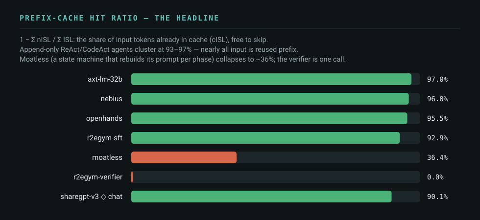

# agent-trace-kv-analyzer



> *Headline finding (generated from the real traces in this repo):* **append-only ReAct/CodeAct agents reuse
> 93–97% of their input as cached prefix**, so only ~3–7% of tokens (nISL) ever need real prefill. A
> **state-machine** agent (Moatless) that rebuilds its prompt per phase collapses to **36%**, and a one-shot
> **verifier** has nothing to reuse. Regenerate this chart with `python build_headline_svg.py`.

Download public **coding-agent trace** datasets, profile their **request shape** (ISL/OSL, steps),
model **prefix-cache reuse** and **KV-cache size**, and render a self-contained **dashboard** — end to end.

Answers, from real traces:
- How much of an agentic prompt is a **prefix-cache hit** (cISL) vs. new prefill (nISL)?
- How big does the **KV cache** get, and how does that change with the serving model (GQA vs MLA)?
- How do these differ across agent harnesses — and vs. a plain **ShareGPT chat** baseline?

## Overview

Coding agents (SWE-agent, OpenHands, Moatless, …) don't send one prompt — they run a **loop**: read an
issue, explore the repo, edit files, run tests, repeat. Each turn re-sends a growing transcript, so the
serving cost is dominated by two things this repo measures directly from real trajectories:

1. **Request shape** — the per-call input length (**ISL**) and output length (**OSL**). Agentic serving is
   *prefill-heavy / decode-light* (ISL ≫ OSL), the opposite of chat.
2. **Prefix-cache reuse** — because each turn appends to the previous context, most of the input is an exact
   prefix the server already has cached (**cISL**); only the new suffix (**nISL**) needs real prefill. How
   much reuse you get depends entirely on the agent's architecture.
3. **KV-cache footprint** — peak context × per-token KV cost, which depends on the *serving model's* attention
   design (GQA vs MLA), not its parameter count.

The pipeline downloads seven public datasets, tokenizes and profiles every session, models the cISL/nISL split
and KV size per dataset, writes a Markdown report + machine-readable `stats.json` for each, and renders a single
self-contained **dashboard** (plus the headline SVG above) — all reproducible from source.

**Why it matters:** as inference gets faster, prefill/KV and the prefix-cache hit rate increasingly govern
agentic serving cost and latency. This repo turns that from hand-waving into numbers measured on real traces.

**Glossary** — **ISL/OSL**: input/output sequence length per LLM call · **cISL**: cached input (prefix hit) ·
**nISL**: new input (must prefill) · **GQA**: grouped-query attention · **MLA**: multi-head latent attention
(compressed KV cache, e.g. DeepSeek / GLM-5.2).

## Quick start

```bash
make setup       # python venv + deps (tiktoken, duckdb, pyarrow, huggingface_hub)
make all         # download (~7 GB) -> analyze -> build dashboard.html
# open dashboard.html in a browser
```

Or step by step:

```bash
python download_datasets.py          # all datasets  (or: ... axt-swe-agent-lm-32b)
python analysis_engine.py axt         # one dataset   (keys below)
python build_dashboard.py             # -> dashboard.html
```

> Uses standard `venv` + `pip`. [`uv`](https://github.com/astral-sh/uv) also works and is faster:
> `uv venv .venv && uv pip install -r requirements.txt`.

## Datasets

Six public coding-agent trace sets (agents resolving real GitHub issues) + a chat baseline.
Downloaded into `agentic_traces/<name>/` (git-ignored; recreate with the download script).

| dir / engine key | source (Hugging Face) | harness (arch) |
|---|---|---|
| `axt-swe-agent-lm-32b` / `axt` | `AxT-dev/swe-agent-lm-32b-r2e-gym-trajectories` | SWE-agent-LM-32B, append-only ReAct (measured tokens) |
| `nebius-swe-agent` / `nebius` | `nebius/SWE-agent-trajectories` | SWE-agent, classic ACI commands |
| `swegym-openhands` / `openhands` | `SWE-Gym/OpenHands-Sampled-Trajectories` | OpenHands (CodeAct), native tool-calling |
| `r2egym-sft` / `r2egym-sft` | `R2E-Gym/R2EGym-SFT-Trajectories` | ReAct `<function=>` (SFT set) |
| `swegym-moatless` / `moatless` | `SWE-Gym/MoatlessTools-Sampled-Trajectories` | Moatless, structured state machine |
| `r2egym-verifier` / `r2egym-verifier` | `R2E-Gym/R2EGym-Verifier-Trajectories` | one-shot verifier / judge |
| `sharegpt-v3` / `sharegpt` | `anon8231489123/ShareGPT_Vicuna_unfiltered` | ShareGPT chat baseline (no tools) |

## What each step produces

- **`analysis_engine.py <key>`** → writes into `agentic_traces/<name>/`:
  - `<name>.md` — human-readable report (ISL/OSL, steps, prefix-cache modeling, KV sizing, tool mix)
  - `<name>.stats.json` — machine-readable stats (consumed by the dashboard)
- **`build_dashboard.py`** → `dashboard.html`, a single self-contained page (no external assets),
  built from the `*.stats.json` files. Open locally or publish as a Claude artifact.
- **`agentic_traces/SUMMARY.md`** — a cross-dataset index (if present).

## How the modeling works

- **Tokens:** measured directly for AxT (provider `token_usage`); tiktoken `o200k_base` elsewhere.
- **Prefix cache:** per session, exact cumulative context per step → split into **cISL** (prior
  prompt, a cache hit) and **nISL** (new growth). Aggregate hit ratio = `1 − Σ nISL / Σ ISL`.
  Context shrink ⇒ flagged as a compaction (non-append-only agents like Moatless).
- **KV-cache size:** peak context × KV-bytes/token.
  - **GQA/MHA:** `2 · layers · kv_heads · head_dim · dtype_bytes`
  - **MLA** (DeepSeek, GLM-5.2): `layers · (kv_lora_rank + qk_rope_head_dim) · dtype_bytes`
  The dashboard prices KV on **GLM-5.2** and **DeepSeek-V3** (both MLA); edit `KV_GLM` / `KV_DSV3`
  in `dashboard_template.html` (or the per-dataset model in `analysis_engine.py`) to change models.

## Repo layout

```
analysis_engine.py        # per-dataset analysis; emits <key>.md + <key>.stats.json
download_datasets.py      # fetch datasets from Hugging Face
build_dashboard.py        # stats.json -> dashboard.html (via template)
dashboard_template.html   # self-contained HTML/CSS/JS template (data injected)
requirements.txt  Makefile  .gitignore
agentic_traces/<name>/    # data (git-ignored) + committed example .md / .stats.json
```

## Caveats

- OSL excludes hidden reasoning tokens (these are non-reasoning open models).
- cISL split is exact for append-only ReAct/CodeAct histories; approximate for state-machine agents.
- KV size depends on the serving model's attention config, not parameter count — it's an assumption, stated on every chart.
- Heavy datasets are sampled (sample sizes are noted in each report).
